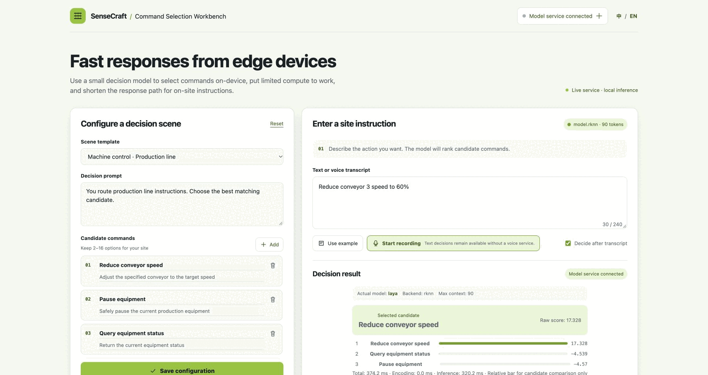

<p align="center">
  <a href="LICENSE"></a>
  
  
  
  
</p>

<h1 align="center">Edge Command Router</h1>

<p align="center"><a href="README.md">English</a> | <a href="README.zh.md">中文</a></p>

<p align="center">
  Self-hosted edge command routing with Laya and Kev — open alternatives to Jev on Rockchip NPU.<br>
  <strong>Fixed candidate commands, local inference, measured responses</strong>
</p>

<p align="center">
  
</p>


## What is this?

**Edge Command Router** accepts context, a natural-language instruction, and a fixed list of
candidate commands. It returns a selected option and ranking scores; it does not execute an
industrial command. The local application contract is [`POST /api/decide`](app/README.md).

This project sits beside three related names:

- [Jev](https://typesafe.ai/jev) is TypeSafe's hosted/commercial System One service.
- [Laya](https://github.com/NandhaKishorM/laya) is an open/self-hosted decision-model path.
- [Kev](https://github.com/jaredpalmer/kev) is an open Jev-like model family. This repository
  uses its pinned adapter and head through the RKLLM backend; it does not claim to implement
  Jev's hosted API or a full `/v1/systemone` drop-in.

The older sections below preserve the Laya conversion, measurement, and acceptance record.
Attribution and pinned artifact revisions are recorded in [`NOTICE`](NOTICE).

## Current Edge Command Router support

| Backend | Target | Runtime input cap | Status |
|---|---|---:|---|
| Laya RKNN | RK3576 | 90 tokens | Real choice path validated |
| Kev RKLLM | RK3576 | 2,048 tokens | Real path and context guard validated |
| Kev RKLLM | RK3588 | 8,192 tokens | Stock deployment verified |
| TensorRT / Laya artifacts | Jetson Orin | Historical seq=512 records | Development target; no current Workbench hardware acceptance |

The one-click deployment entry is the [SenseCraft Edge Command Router solution](https://github.com/suharvest/sensecraft-solutions/tree/main/solutions/edge_command_workbench).
The paired context-500 evaluation selected the exact expected option ID in **189/240 requests
(78.75%) on each RK3576 and RK3588 run**. It uses neutral synthetic background text to reach
exactly 500 assembled tokens; this is a length-extension evaluation, not a claim about
accuracy on naturally complex long tasks. See [`experiments/jev-20261011/context500/README.md`](experiments/jev-20261011/context500/README.md).

## Historical Laya conversion performance

Fixed buckets, `seq = 512`. `top1` is the argmax over the model's live candidate classes on 16
held-out samples; `order_exact` is the full ranking of those classes. Reference is ONNX Runtime
fp32.

| Platform | Artifact | p50 | p95 | min | top1 | order_exact |
|---|---|---|---|---|---|---|
| **RK3588** (Radxa ROCK 5T) | `oldship.s512.m16.fp16.nanguard.sharedmask.rk3588.rknn` | **509 ms** | ≤598 ms | 493.7 ms | **16/16** | 15/16 |
| **Jetson Orin NX** | `laya.s512.fp16.engine` | **18.9 ms** | 24.8 ms | — | **16/16** | 16/16 |
| Jetson Orin Nano | same engine | 22.0 ms | 22.9 ms | — | **16/16** | 16/16 |

The two platforms differ by **27×**. Both match the fp32 reference on top1 for all 16 samples;
the RKNN model differs on the full ordering of one. Neither is bit-identical to the fp32
reference — fp16 output diverges from fp32 at the third decimal while preserving the ordering.

RK3588 p50 is only reproducible with the CPU governor pinned to `performance` — see
[`docs/measurement.md`](docs/measurement.md).

## What you get

- **Working conversion chain** for both platforms, including the ONNX graph surgery laya
  specifically requires. The mask construction in laya's export breaks RKNN accuracy unless two
  independent defects are fixed first; both are documented and scripted.
- **Measured numbers, not estimates** — latency, accuracy and memory, per platform, with the
  measurement protocol that produced them.
- **A quantized path that actually engages the INT8 tensor cores** (247/259 layers on Orin,
  `i8i8→i32`), and the reason its accuracy is still unusable.
- **Negative results with mechanisms**: six quantization attempts across three platforms, each
  failing for a different, identified reason. The ceiling is the quantization scheme, not the
  silicon.
- **The historical Laya model's own limits**, measured separately from the deployment: 8k context does not work,
  and it does not work in fp32 either.
- **A ranking-based acceptance protocol** that would have caught two failures that `rel_l2`
  and layer tables both reported as passing.

## Edge Command Router local preview / development

This command starts the local FastAPI service and UI with the default unavailable backend.
It is for interface and API development; it does not load a model or perform inference.

~~~bash
cd app
uv sync --extra test
uv run edge-workbench --host 127.0.0.1 --port 8000
~~~

For a ready model-backed deployment, use the [SenseCraft Edge Command Router solution](https://github.com/suharvest/sensecraft-solutions/tree/main/solutions/edge_command_workbench)
and its target-specific deployment inputs. The [service contract and runtime notes](app/README.md)
describe the operator-supplied model, tokenizer, head, and runtime artifacts.

## Historical conversion acceptance quick start

Run the acceptance test against a converted artifact. This is the check every number in this
repository was gated on, and it is the check to run against us.

```bash
git clone https://github.com/suharvest/laya-on-rk3588-jetson
cd laya-on-rk3588-jetson
```

**1. On the target device** — run the converted model, dump what it decided:

```bash
python3 scripts/47_device_dump.py \
    --rknn   /path/to/oldship.s512.m16.fp16.nanguard.sharedmask.rk3588.rknn \
    --name   prod \
    --heldout calib/heldout \
    --out    dump.prod.json \
    --core-mask 0_1_2
```

**2. On any host** — score that dump against the fp32 reference:

```bash
python3 scripts/live_rank.py \
    --ref    golden/ortdump.s512.json \
    --dump   prod=dump.prod.json \
    --heldout calib/heldout \
    --out    rank.prod.json
```

The output is a per-sample table of the **live** candidate classes in ranked order, plus a
Kendall statistic. `--dump` is repeatable: pass several to compare models side by side in one
table.

Converted artifacts and the ONNX sources are published on Hugging Face:

| Artifact | Where |
|---|---|
| `.rknn`, `.engine`, both source `.onnx` files | [`harvestsu/laya-multilingual-rknn-tensorrt`](https://huggingface.co/harvestsu/laya-multilingual-rknn-tensorrt) |
| calibration + held-out sets, ORT reference | the same repository, under `calib/` and `golden/` (also committed here) |

Sizes and md5s for everything: [`ARTIFACTS.md`](ARTIFACTS.md).

## Conversion pipeline

```
HuggingFace checkpoint — convaiinnovations/laya-multilingual
        │
        ├── Rockchip path ──────────────────────────────────────────────────
        │     ONNX export (fp32)          seq bucket fixed here; mandatory
        │       │
        │       ├─ NaN guard repair       RKNPU has no IsNaN kernel
        │       ├─ attention-guard strip  removes a construct RKNN mis-lowers
        │       └─ mask-sharing surgery   22 per-layer masks → one shared mask
        │       │
        │       └─► rknn-toolkit2  --target rk3588 --optimization-level 3
        │                                │
        │                                └─► .rknn   663 MB, fp16
        │
        └── Jetson path ────────────────────────────────────────────────────
              ONNX export (a separate export; the two platforms do not share
              an ONNX graph in this repository)
                │
                └─► trtexec --fp16 --memPoolSize=workspace:2048   (sm_87)
                                │
                                └─► .engine 651 MB, fp16
```

The mask-sharing step is both an accuracy fix and a 209 ms latency fix on RK3588 — the two
problems have the same origin but are independent dimensions. See
[`docs/rk3588.md`](docs/rk3588.md).

## Configuration

| Knob | Where | Value used here | Effect |
|---|---|---|---|
| `seq` bucket | ONNX export | 512 | Fixed at export; short inputs are billed at 512 |
| `target_platform` | rknn-toolkit2 | `rk3588` | A rk3588 model is hard-rejected by an RK3576 runtime — convert separately |
| `optimization_level` | rknn-toolkit2 | 3 | |
| `core_mask` | rknnlite | `0_1_2` | Accepts enum values only; bit arithmetic is rejected |
| CPU governor | host | `performance` | RK3588 p50 is not reproducible without it |

## Documentation

| Doc | Contents |
|---|---|
| [`docs/rk3588.md`](docs/rk3588.md) | Rockchip path: the `H×W ≤ 8192` surface limit, graph surgery, conversion, results |
| [`docs/jetson.md`](docs/jetson.md) | TensorRT path: engine build, CUDA Graph, per-node bottleneck breakdown |
| [`docs/quantization.md`](docs/quantization.md) | Six attempts across three platforms, and where the ceiling actually is |
| [`docs/acceptance.md`](docs/acceptance.md) | The acceptance protocol, and three ways `rel_l2` and layer tables lied |
| [`docs/measurement.md`](docs/measurement.md) | Measurement discipline — how to get a number that reproduces |
| [`docs/context-length.md`](docs/context-length.md) | Long-context probe: 512 / 2048 / 8192, per language and per position |
| [`ARTIFACTS.md`](ARTIFACTS.md) | Every artifact with size and md5, and the exact ONNX each was built from |
| [`MANIFEST.md`](MANIFEST.md) | Pinned dependency manifests and upstream revisions, for rebuilds |

## Contributing

Issues and PRs are welcome, particularly:

- conversions for other Rockchip targets (RK3576, RK3588S) or other NPUs
- quantization schemes that survive the outlier channels per-tensor INT8 cannot
- reproductions or refutations of any number here — the acceptance protocol is in
  [`docs/acceptance.md`](docs/acceptance.md) and is meant to be run against us

## Acknowledgements

Built on [`NandhaKishorM/laya`](https://github.com/NandhaKishorM/laya) and
[`convaiinnovations/laya-multilingual`](https://huggingface.co/convaiinnovations/laya-multilingual),
both Apache-2.0. Upstream revisions and attribution are in [`NOTICE`](NOTICE).

Toolchains: [`rknn-toolkit2`](https://github.com/airockchip/rknn-toolkit2) (2.3.2),
TensorRT 10.3.0, onnx-graphsurgeon, ONNX Runtime.

## License

[Apache License 2.0](LICENSE). Converted artifacts are derivative works of
`laya-multilingual` and carry the same license and attribution.

This project is not affiliated with TypeSafe AI, Inc. "Jev" is their product; the references
here are descriptive.

## Command Selection Workbench

`app/` contains the local FastAPI service and static UI for RK3576 RKNN `seq=90` and the Kev RKLLM command-selection path. A separate cat-remote 8K attempt reached 7819 actual tokens and hit global OOM. The later RK3576 Kev 2K deployment guard rejected a 2088-token over-limit request with HTTP 422 before NPU execution. Kev RKLLM 8K is now verified on a stock Radxa RK3588 deployment. The Jetson native Kev path remains historical and has not completed hardware validation. The ARM64 image, model, tokenizer, and metadata are published under the recorded release path in the `harvestsu/laya-multilingual-rknn-tensorrt` Hugging Face repository.

The UI supports Chinese and English. Language switching localizes only an untouched built-in scene; user-edited prompt, candidate fields, input, history, and device settings remain as entered. See [`app/README.md`](app/README.md) for the remote API, RKNN runtime mounts, health requirements, and validation record. The device evidence is in [`docs/rk3576-cat-validation-20261009.md`](docs/rk3576-cat-validation-20261009.md); conversion constraints are in [`docs/rk3576-conversion-20261009.md`](docs/rk3576-conversion-20261009.md). The current release evidence is [`RK3576 second validation`](docs/interaction-review-ef82-20261011/rk3576-final-release/second-validation/) and [`RK3588 stock release`](docs/interaction-review-ef82-20261011/rk3588-final-release/).

## Multi-platform Workbench runtime

The application API is shared across backends, while runtime images remain target-specific. RKNN and TensorRT share the five-input native contract; RKLLM uses an independent token/hidden-state adapter. RK3576 RKNN `seq=90` and the Kev RKLLM 2K guard are validated; Kev RKLLM 8K is verified on a stock RK3588 device. The Jetson Orin native Kev path remains historical and requires independent model, tokenizer, runtime, and hardware acceptance. See [docs/multiplatform-runtime.md](docs/multiplatform-runtime.md) and [app/README.md](app/README.md).


## Kev context-500 benchmark

The reproducible method, full per-device results, raw JSONL, summaries, analyses, and SHA256 evidence are in [`experiments/jev-20261011/context500/README.md`](experiments/jev-20261011/context500/README.md). The benchmark uses 60 paired English/Chinese semantic groups (120 language samples), 4–7 candidates per request, exact 500-token Kev assemblies, and original/reverse option order for 240 scored requests per device. The 500-token context is a neutral synthetic background extension for measurement, not a natural complex-task accuracy claim. The recorded release uses image `edge-command-workbench:rockchip-rkllm-0.3.1-review` and Hugging Face revision `db0545065d4da3598d009407fc3bd0c7632ca199`.

| device | HTTP | correct | accuracy | client mean / p50 / p95 |
|---|---:|---:|---:|---:|
| RK3576 | 240/240 | 189/240 | 78.75% | 7220.982 / 7115.307 / 7574.560 ms |
| RK3588 | 240/240 | 189/240 | 78.75% | 3958.615 / 3946.517 / 4770.961 ms |

Accuracy is exact `selected_option_id` match. False-action entries are model selection errors for expected `clarify`/`reject`; this benchmark sent decision requests and did not execute industrial commands. The two devices use different chip, quantization, and deployment context-guard configurations, so the result does not isolate quantization as a cause.

## Verified Kev workbench UI evidence

The final device check for the command-selection UI used the Radxa service at `http://192.0.2.16:18769/`. The recorded service identity was `model_id=kev`, `backend=rkllm`, `max_sequence_tokens=8192`, and `max_options=16`. The evidence index, screenshots, AX snapshots, and three-frame GIF montage are in [`docs/kev-final-qa-20261011.md`](docs/kev-final-qa-20261011.md). The screenshots were captured before the later display-only rounding change; API and evidence JSON retain raw score and timing values.

### Public evidence network-address handling

Public text evidence replaces private Fleet/LAN host addresses with RFC 5737 documentation addresses. Loopback addresses used by the synthetic benchmark remain unchanged. Original evidence bytes and their hashes are retained in a private audit workspace; public hashes refer to the sanitized copies.
