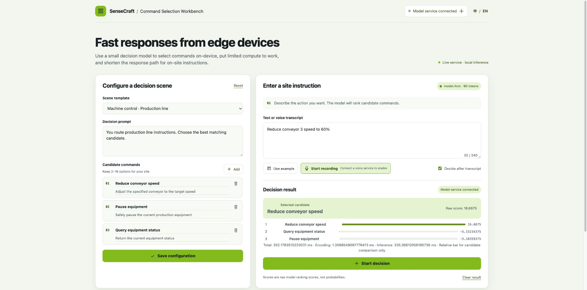
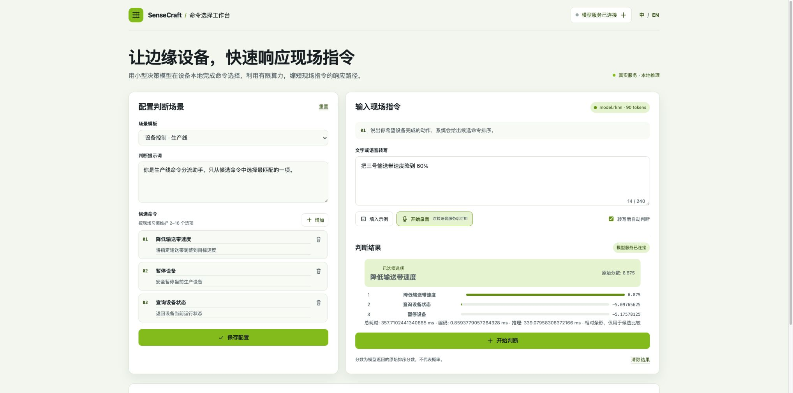

# Edge Workbench service

This directory contains the local FastAPI service used by the command selection workbench. It serves `/api/health`, `/api/health/remote`, `/api/decide`, and the same origin WebSocket voice relay at `/api/voice/stream`.

Run it with a small Python environment:

```sh
uv sync --extra test
uv run edge-workbench --host 127.0.0.1 --port 8000
```

The default is `DECISION_BACKEND=unavailable`. In that state the UI and health endpoint stay available, while `/api/decide` returns HTTP 503 with `model_unavailable`; the service never produces heuristic or mock decisions. Settings are read from `DECISION_BACKEND` (`unavailable`, `rknn`, `tensorrt`, `http`), `MODEL_PATH`, `TOKENIZER_PATH`, `SEQ_LEN` (90 or 512), `MAX_OPTIONS`, `DECISION_SERVICE_URL`, and `VOICE_SERVICE_URL`. Tokenizers and model files are local only. No startup path downloads weights.

For a remote decision service, set `DECISION_BACKEND=http` and `DECISION_SERVICE_URL=http://device:port`, or pass `model_service_url` per request. The proxy strips that field before forwarding, validates option IDs and finite ranking scores, and measures its own elapsed time. An HTTP backend delegates token-budget validation to the target service instead of applying a local tokenizer limit first. Remote URLs may use only `http` or `https` and cannot contain credentials or fragments.

For RKNN/TensorRT, install the target vendor runtime in the device environment and create the environment with `uv venv --system-site-packages && uv sync`; the lock file deliberately excludes torch, CUDA, TensorRT, RKNN, CuPy, and model binaries. The native adapters load only when the selected vendor runtime and model metadata are compatible. Compilation or import success alone is not device validation. Device validation must run the real artifact and compare choice logits; `act_logits` are never used for rejection or execution permission.

The existing browser prototype is under `prototype/`. The production static bundle is expected under `web/` and is mounted at `/` when present. The service does not execute selected commands.

Run tests with `uv run --extra test pytest -q`.

Native Laya choice inference

Set `DECISION_BACKEND=rknn` or `DECISION_BACKEND=tensorrt`, `MODEL_PATH` to a local model, and
`TOKENIZER_PATH` to the local tokenizer directory containing `tokenizer.json` plus
`tokenizer_config.json` and/or `special_tokens_map.json`. The native path uses the `tokenizers`
package directly; it does not instantiate `laya.Agent`, torch, or transformers. `SEQ_LEN` must
match the model input shape. A JSON model metadata file can be supplied with
`MODEL_METADATA_PATH`; when it declares `seq_len`, a mismatch makes the backend unavailable.

On a device environment with vendor libraries already installed, use `uv venv
--system-site-packages && uv sync` so the environment can see RKNN/TensorRT and CUDA libraries.
The project lock file does not install those vendor libraries, GPU runtimes, or model files.
`RKNN_CORE=auto` is the default; set an explicit core mask only when the installed RKNN runtime
and board support it. The native request is the five named inputs `input_ids`, `attention_mask`,
`marker_pos`, `marker_mask`, and `qtype`; packed inputs are rejected. Choice head logits must be
finite. Native input text is never silently truncated: an overlong head, option, or assembled
sequence returns HTTP 422 with `input_too_long`.

## Command Selection Workbench / 命令选择工作台

The Workbench is a small-device, single-decision application. It accepts a text instruction or a Local Voice transcript, selects one candidate from the submitted options, and uses limited edge compute to shorten the response path. The UI follows the lightweight static-page strategy (design strategy C). It selects an option only; it does not execute an on-site command. User configuration and history remain in the browser's local storage.

命令选择工作台面向小设备完成单次选择：输入文字或 Local Voice 转写，模型从候选项中选择一个，用有限算力缩短现场指令的响应路径。界面采用策略 C 的轻量静态页面。服务只返回选择结果，不执行现场命令；用户配置和历史记录保存在浏览器本地。

The model service can be replaced by the local HTTP, RKNN, or TensorRT backend. The default is a real `unavailable` state: health remains readable, while a decision returns `503 model_unavailable`; the UI never substitutes a heuristic or mock result. From this directory, create a vendor-aware environment and start the service with:

```sh
uv venv --system-site-packages
uv sync
uv run edge-workbench --host 127.0.0.1 --port 8000
```

The static production UI is `app/web/`; the earlier browser prototype is `app/prototype/`. `--host` and `--port` are passed to `uv run edge-workbench`, and the service serves `web/` at `/` when that directory is present. Reported timings are the returned measured milliseconds and are not probabilities.

Environment settings are `MODEL_PATH`, `TOKENIZER_PATH`, `MODEL_METADATA_PATH`, `SEQ_LEN` (the model sequence length), `MAX_OPTIONS` (16 by default and capped at 16), `RKNN_CORE` (`auto` by default), `VOICE_SERVICE_URL`, and `DECISION_SERVICE_URL`. `DECISION_BACKEND` selects `unavailable`, `rknn`, `tensorrt`, or `http`. Model and tokenizer directories are supplied by the operator; startup does not download weights.

The RK3576 `seq=90` artifact is a choice-only offline artifact for up to 16 options. Its `acthead` output is not used and a NaN acthead does not grant execution permission. The RK3588 `seq=512` and Jetson Orin `seq=512` acceptance records are separate historical artifact checks. Their historical speed figures must not be read as a new Workbench benchmark. The RK3576 ARM64 image and model were exercised on the validated cat board with the real RKNN runtime; the Chinese default scenario completed a real decision request. RK3588 and Jetson remain historical targets outside this Workbench validation.

### Remote API compatibility / Remote API 兼容协议

`POST /api/decide` accepts JSON shaped like this:

```json
{"input_text":"pause line 3","prompt":"Choose one command","options":[{"id":"pause","label":"Pause","description":"Pause the line"},{"id":"status","label":"Status","description":"Read status"}],"model_service_url":""}
```

The response contains `request_id`, `selected_option_id` (or `null` when rejected), an `option_id`/`score` ranking, measured `timings` (`encoding_ms`, `inference_ms`, `total_ms`), `model`, and `rejected`. A remote-compatible service must return the same JSON contract. Overlong input returns a structured error such as `{"detail":{"code":"input_too_long","message":"assembled input has 513 tokens; maximum is 512","max_tokens":512,"actual_tokens":513}}`; the service does not silently truncate.

`GET /api/health` and `POST /api/health/remote` return `status`, `model_ready`, `backend`, `name`, `max_sequence_tokens`, and `max_options`, with an optional `reason` when unavailable. The voice relay is `WS /api/voice/stream?voice_url=...`; it forwards PCM16 frames and returns the Local Voice JSON events without exposing a browser speech-recognition fallback.

## RK3576 ARM64 container

The first complete container target is the RK3576 `seq=90`, 16-option choice artifact. The image contains this app and the AArch64 CPython 3.11 RKNN Lite2 wheel; it does not contain the model or tokenizer. The model directory is supplied by the host at runtime, and the matching host RKNN runtime library is mounted read-only at both loader paths.

The wheel is the official file `rknn_toolkit_lite2-2.3.2-cp311-cp311-manylinux_2_17_aarch64.manylinux2014_aarch64.whl` from the `airockchip/rknn-toolkit2` repository at commit `59a913d172e7f5ff03c9076e2ec7b1b1288ffd08`. GitHub reports blob SHA `bf57672255cc7ce2fa141d6e0ae3f7dafcee2527`, size `569160` bytes; the downloaded file must also verify SHA256 `bda74f1179e15fccb8726054a24898982522784b65bb340b20146955d254e800`. The SDK license is `RKNN-TOOLKIT2-LICENSE` from the same commit and must remain available to the image reviewer.

Prepare a temporary build context outside the repository with `docker/vendor/` containing the wheel and license, then build the ARM64 image as `edge-command-workbench:rk3576-0.1.1`. The provided [`docker/Dockerfile`](docker/Dockerfile) runs `uv sync --frozen --no-dev`, installs the vendor wheel with `uv pip --no-deps`, copies only `edge_workbench` and `web`, and starts on port `18768`.

At runtime, provide a RK3576 model directory containing `laya-multilingual.s90.m16.fp16.nanfix.rk3576.rknn`, `tokenizer/`, and mount the board's matching `librknnrt.so` file read-only to both loader paths. `MODEL_METADATA_PATH` is empty for this bundle. A minimal invocation is:

```sh
docker run --rm --name edge-command-workbench \
  --network host \
  --security-opt systempaths=unconfined \
  --device /dev/dri:/dev/dri \
  -v /proc/device-tree/compatible:/proc/device-tree/compatible:ro \
  -v /sys/firmware/devicetree/base:/sys/firmware/devicetree/base:ro \
  -v /opt/laya-rk3576/model:/models:ro \
  -v /usr/lib/librknnrt.so:/usr/lib/librknnrt.so:ro \
  -v /usr/lib/librknnrt.so:/opt/rknn/librknnrt.so:ro \
  -e MODEL_PATH=/models/model.rknn \
  edge-command-workbench:rk3576-0.1.1
```

`--network host` lets an optional `VOICE_SERVICE_URL=http://127.0.0.1:<port>` reach a Local Voice service on the host. Use the actual single host `librknnrt.so` file; do not bind the whole host `/usr/lib`. On the validated cat RK3576, `/dev/dri/card1` is the NPU DRM primary node, so the complete `/dev/dri` directory is mapped. The image healthcheck requires `/api/health` to report `model_ready=true`, `backend=rknn`, `max_sequence_tokens=90`, and `max_options=16`; an HTTP 200 response with an unavailable model fails the healthcheck. `VOICE_SERVICE_URL` remains optional and points to an already running Local Voice service.

The browser microphone helper is vendored from [Seeed-Solution/openvoicestream](https://github.com/Seeed-Solution/openvoicestream) at commit `8fdc52ea65ce9a5dfd5dfe7e8b5d25943c269a11`; its source paths, blob IDs, SHA256 values, and MIT license are recorded under `web/vendor/openvoicestream/`.

The public RK3576 model artifact must be downloaded separately from its recorded source and verified before the container starts. RK3588 `seq=512` and Jetson TensorRT artifacts are separate historical targets and are not covered by this image.


### Language switching and saved defaults / 语言切换与默认配置

When the current prompt and all candidate commands still exactly match a built-in scene in either language, switching the language replaces that untouched default template with the target language. A saved untouched Chinese default is also localized when the page is first opened with `?lang=en`. Any edited prompt, candidate name or description, input text, history, and device settings remain unchanged.

如果当前提示词和全部候选命令仍与任一语言的内置场景完全一致，切换语言会将未编辑的默认模板替换为目标语言。使用 `?lang=en` 首次打开时，已保存的未编辑中文默认模板也会本地化。用户编辑过的提示词、候选名称或说明、输入文本、历史记录和设备配置保持不变。

### Spark UI evidence / Spark 界面证据

The 0.1.1 development candidate was opened from Spark at `:18868` with `DECISION_BACKEND=http` and proxied the real RK3576 service at `100.89.94.11:18768`. The Chinese default scene selected `cmd-1` in 357.710 ms total (339.080 ms inference); the English scene selected `cmd-1` in 352.178 ms total (335.366 ms inference). These screenshots document the development candidate and are not a release claim.

候选版本 0.1.1 在 Spark `:18868` 打开，设置 `DECISION_BACKEND=http`，请求转发到 `100.89.94.11:18768` 的真实 RK3576 服务。中文默认场景选择 `cmd-1`，总耗时 357.710 ms、推理 339.080 ms；英文场景选择 `cmd-1`，总耗时 352.178 ms、推理 335.366 ms。截图仅记录开发候选版本，不代表发布版本声明。




